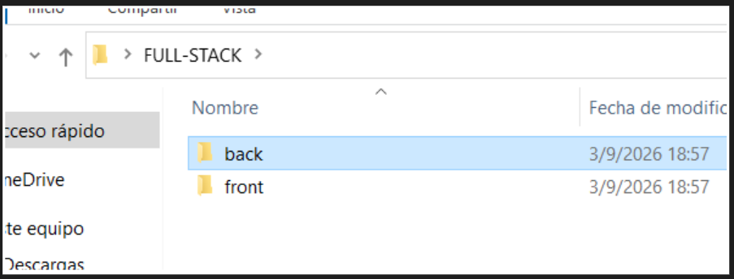
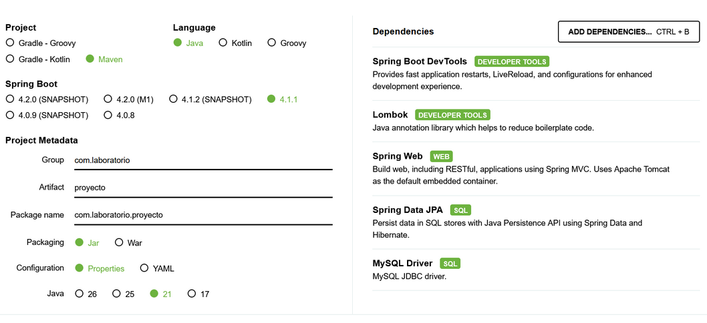
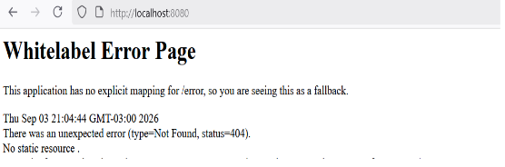
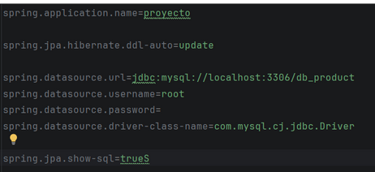
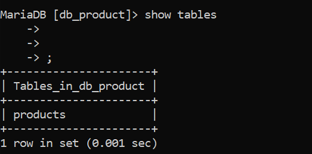
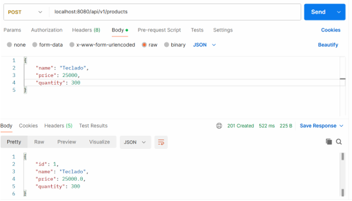
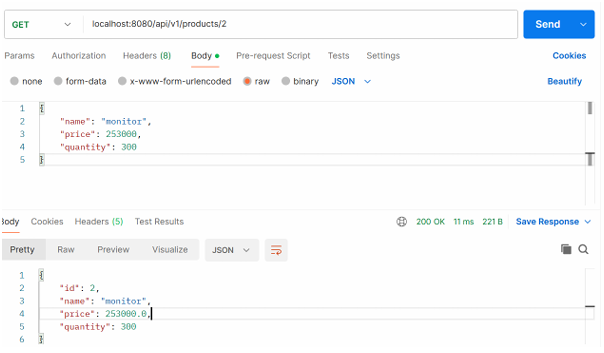

# Documentación: CRUD Spring Boot - JavaScript - MySQL

## Requisitos y Tecnologías
* **IDE:** NetBeans / IntelliJ IDEA / VS Code
* **Entorno / Servidor:** XAMPP, Postman
* **Backend:** Spring Boot, Java 21, Spring Data JPA, Maven, Lombok
* **Base de Datos:** MySQL
* **Frontend:** HTML5, CSS3, JavaScript (ES6+), Bootstrap 4.5.2

---

## Introducción
Esta aplicación consiste en un **CRUD Full Stack** simple con arquitectura cliente-servidor:
* **Backend:** API RESTful desarrollada con Spring Boot y base de datos MySQL, organizada en capas (Controller, Service, Repository, Entity, DTO).
* **Frontend:** Aplicación web cliente utilizando HTML, CSS, JavaScript e integración con la API mediante Fetch API.


## Resumen de Tareas de Desarrollo

| Tarea | Descripción |
|---|---|
| **TAREA 1** | Crear la base de datos en MySQL y la estructura de directorios |
| **TAREA 2** | Generar el proyecto inicial en Spring Initializr |
| **TAREA 3** | Verificar despliegue inicial del backend |
| **TAREA 4** | Crear la estructura de paquetes/capas en Java |
| **TAREA 5** | Configurar `application.properties` para MySQL |
| **TAREA 6** | Crear la entidad `Product` con anotaciones JPA y Lombok |
| **TAREA 7** | Crear la interfaz `ProductRepository` |
| **TAREA 8** | Implementar `ProductService` y `ProductServiceImpl` |
| **TAREA 9** | Crear los endpoints en `ProductController` |
| **TAREA 10**| Probar los endpoints REST con Postman |

---

## Paso a Paso: Desarrollo del Backend

### TAREA 1: Base de datos y Estructura de Proyecto

1. **Crear la base de datos MySQL:**


2. **Crear la estructura de carpetas local:**



---

### TAREA 2: Configuración en Spring Initializr

Acceder a [start.spring.io](https://start.spring.io/) con los siguientes datos:
* **Project:** Maven
* **Language:** Java
* **Spring Boot:** 3.2.x (o superior)
* **Group:** `net.laboratorioderedes`
* **Artifact / Name:** `api-product`
* **Package name:** `net.laboratorioderedes.product`
* **Packaging:** Jar
* **Java:** 21

**Dependencias agregadas:**
1. **Spring Boot DevTools**
2. **Lombok**
3. **Spring Web**
4. **Spring Data JPA**
5. **MySQL Driver**



---

### TAREA 3: Verificación de Despliegue Inicial

1. Para probar la ejecución sin configurar aún la base de datos, comentar temporalmente la dependencia `spring-boot-starter-data-jpa` en el `pom.xml`.
2. Iniciar la aplicación y acceder a `http://localhost:8080` para verificar la pantalla `Whitelabel Error Page` (confirmación de que Tomcat está activo).



---

### TAREA 4: Estructura de Capas

Crear los siguientes paquetes dentro de `net.laboratorioderedes.product`:
* `controller`
* `entity`
* `repository`
* `service`


---

### TAREA 5: Configuración de `application.properties`

Ubicación: `src/main/resources/application.properties`


---

### TAREA 6: Creación de la Entidad `Product`

Asegurarse de descomentar la dependencia de Spring Data JPA en `pom.xml`.

Ubicación: `net.laboratorioderedes.product.entity.Product.java`

```java
package net.laboratorioderedes.product.entity;

import jakarta.persistence.Entity;
import jakarta.persistence.GeneratedValue;
import jakarta.persistence.GenerationType;
import jakarta.persistence.Id;
import jakarta.persistence.Table;
import lombok.AllArgsConstructor;
import lombok.Data;
import lombok.NoArgsConstructor;

@NoArgsConstructor
@AllArgsConstructor
@Data
@Entity
@Table(name = "products")
public class Product {

    @Id
    @GeneratedValue(strategy = GenerationType.IDENTITY)
    private Long id;

    private String name;
    private double price;
    private int quantity;
}
```

---

### TAREA 7: Creación del Repositorio

Ubicación: `net.laboratorioderedes.product.repository.ProductRepository.java`

```java
package net.laboratorioderedes.product.repository;

import net.laboratorioderedes.product.entity.Product;
import org.springframework.data.jpa.repository.JpaRepository;
import org.springframework.stereotype.Repository;

@Repository
public interface ProductRepository extends JpaRepository<Product, Long> {
}
```

#### Verificación en la Base de Datos
Al ejecutar el proyecto con MySQL encendido (XAMPP), Hibernate creará automáticamente la tabla `products`. Podemos verificarlo desde la consola MariaDB/MySQL:

```sql
MariaDB [db_product]> SHOW TABLES;
MariaDB [db_product]> DESCRIBE products;
```




---

### TAREA 8: Implementación de la Capa Service

#### 1. Interfaz de Servicio
Ubicación: `net.laboratorioderedes.product.service.ProductService.java`

```java
package net.laboratorioderedes.product.service;

import net.laboratorioderedes.product.entity.Product;
import java.util.List;

public interface ProductService {
    Product createProduct(Product product);
    List<Product> getAllProducts();
    Product getProductById(Long productId);
    Product updateProduct(Long productId, Product product);
    Product deleteProductById(Long productId);
}
```

#### 2. Implementación del Servicio
Ubicación: `net.laboratorioderedes.product.service.ProductServiceImpl.java`

```java
package net.laboratorioderedes.product.service;

import jakarta.persistence.EntityNotFoundException;
import net.laboratorioderedes.product.entity.Product;
import net.laboratorioderedes.product.repository.ProductRepository;
import org.springframework.beans.factory.annotation.Autowired;
import org.springframework.stereotype.Service;

import java.util.List;
import java.util.Optional;

@Service
public class ProductServiceImpl implements ProductService {

    @Autowired
    private ProductRepository productRepository;

    @Override
    public Product createProduct(Product product) {
        return productRepository.save(product);
    }

    @Override
    public List<Product> getAllProducts() {
        return productRepository.findAll();
    }

    @Override
    public Product getProductById(Long productId) {
        return productRepository.findById(productId)
                .orElseThrow(() -> new EntityNotFoundException("Product not found with id " + productId));
    }

    @Override
    public Product updateProduct(Long productId, Product product) {
        Product existingProduct = productRepository.findById(productId)
                .orElseThrow(() -> new EntityNotFoundException("Product not found with id " + productId));

        existingProduct.setName(product.getName());
        existingProduct.setPrice(product.getPrice());
        existingProduct.setQuantity(product.getQuantity());

        return productRepository.save(existingProduct);
    }

    @Override
    public Product deleteProductById(Long productId) {
        Optional<Product> optionalProduct = productRepository.findById(productId);
        if (optionalProduct.isPresent()) {
            productRepository.deleteById(productId);
            return optionalProduct.get();
        }
        return null;
    }
}
```

---

### TAREA 9: Controlador REST

Ubicación: `net.laboratorioderedes.product.controller.ProductController.java`

```java
package net.laboratorioderedes.product.controller;

import jakarta.persistence.EntityNotFoundException;
import net.laboratorioderedes.product.entity.Product;
import net.laboratorioderedes.product.service.ProductService;
import org.springframework.beans.factory.annotation.Autowired;
import org.springframework.http.HttpStatus;
import org.springframework.http.ResponseEntity;
import org.springframework.web.bind.annotation.*;

import java.util.List;

@RestController
@RequestMapping("/api/v1")
public class ProductController {

    @Autowired
    private ProductService productService;

    @PostMapping("/products")
    public ResponseEntity<Product> saveProduct(@RequestBody Product product) {
        return ResponseEntity.status(HttpStatus.CREATED).body(productService.createProduct(product));
    }

    @GetMapping("/products")
    public ResponseEntity<List<Product>> getAllProducts() {
        return ResponseEntity.ok(productService.getAllProducts());
    }

    @GetMapping("/products/{id}")
    public ResponseEntity<Product> getProductById(@PathVariable Long id) {
        return ResponseEntity.ok(productService.getProductById(id));
    }

    @PutMapping("/products/{id}")
    public ResponseEntity<Product> updateProduct(@PathVariable Long id, @RequestBody Product product) {
        Product existingProduct = productService.getProductById(id);
        if (existingProduct == null) {
            throw new EntityNotFoundException("Product not found with id: " + id);
        }
        return ResponseEntity.ok(productService.updateProduct(id, product));
    }

    @DeleteMapping("/products/{id}")
    public ResponseEntity<String> deleteProduct(@PathVariable Long id) {
        productService.deleteProductById(id);
        return ResponseEntity.ok("Product deleted successfully");
    }

    @ExceptionHandler(EntityNotFoundException.class)
    public ResponseEntity<String> handleEntityNotFoundException(EntityNotFoundException ex) {
        return ResponseEntity.status(HttpStatus.NOT_FOUND).body(ex.getMessage());
    }
}
```

---

### TAREA 10: Pruebas de Endpoints con Postman

1. **CREATE metodo para ingresar los datos**


2. **READ ALL lee lo de post**

   

3. **READ BY ID muestra por id y te muestra lo que pusiste en post**

   

4. **UPDATE  el put actualiza “update”**

  

5. **DELETE borra el producto que ingresaste por id**
   
  

---

## Frontend: Desarrollo de la Interfaz Web

### Flujo de Datos del Frontend
1. Al cargar el documento HTML, se desencadena el evento `DOMContentLoaded` e invoca la función principal para obtener los productos (`GET`).
2. Se renderiza la lista de datos dentro de la tabla HTML.
3. Cada fila generada incluye botones para **Editar** (`PUT`) y **Eliminar** (`DELETE`).
4. El formulario maneja el evento `submit` para enviar solicitudes de creación (`POST`) o edición (`PUT`).

---

### Tarea 1: Estructura HTML (`index.html`)

Ubicación: `front/index.html`

```html
<!DOCTYPE html>
<html lang="en">
<head>
    <meta charset="UTF-8">
    <meta name="viewport" content="width=device-width, initial-scale=1.0">
    <title>CRUD Productos</title>
    <link href="https://stackpath.bootstrapcdn.com/bootstrap/4.5.2/css/bootstrap.min.css" rel="stylesheet">
</head>
<body>
    <div class="container mt-5">
        <h1 class="text-center">CRUD de Productos</h1>
        
        <!-- Formulario para agregar/editar productos -->
        <div class="card mb-4">
            <div class="card-body">
                <h5 class="card-title">Agregar/Editar Producto</h5>
                <form id="product-form">
                    <input type="hidden" id="product-id">
                    <div class="form-group">
                        <label for="name">Nombre</label>
                        <input type="text" class="form-control" id="name" required>
                    </div>
                    <div class="form-group">
                        <label for="price">Precio</label>
                        <input type="number" class="form-control" id="price" required>
                    </div>
                    <div class="form-group">
                        <label for="quantity">Cantidad</label>
                        <input type="number" class="form-control" id="quantity" required>
                    </div>
                    <button type="submit" class="btn btn-primary">Guardar</button>
                </form>
            </div>
        </div>

        <!-- Tabla para mostrar productos -->
        <div class="card">
            <div class="card-body">
                <h5 class="card-title">Lista de Productos</h5>
                <table class="table">
                    <thead>
                        <tr>
                            <th>ID</th>
                            <th>Nombre</th>
                            <th>Precio</th>
                            <th>Cantidad</th>
                            <th>Acciones</th>
                        </tr>
                    </thead>
                    <tbody id="product-table">
                        <!-- Aquí se agregarán los productos dinámicamente -->
                    </tbody>
                </table>
            </div>
        </div>
    </div>

    <script src="script.js"></script>
</body>
</html>
```

---

### Tareas 2 a 9: Lógica JavaScript (`script.js`)

Ubicación: `front/script.js`

```javascript
const apiUrl = 'http://localhost:8080/api/v1/products';

document.addEventListener('DOMContentLoaded', () => {
    fetchProducts();
});

// Tareas 2 y 3: Obtener y renderizar productos
function fetchProducts() {
    fetch(apiUrl)
        .then(response => response.json())
        .then(data => {
            const productTable = document.getElementById('product-table');
            productTable.innerHTML = '';
            data.forEach(product => {
                const row = document.createElement('tr');
                row.innerHTML = `
                    <td>${product.id}</td>
                    <td>${product.name}</td>
                    <td>${product.price}</td>
                    <td>${product.quantity}</td>
                    <td>
                        <button class="btn btn-warning btn-sm edit-btn" data-id="${product.id}">Editar</button>
                        <button class="btn btn-danger btn-sm delete-btn" data-id="${product.id}">Eliminar</button>
                    </td>
                `;
                productTable.appendChild(row);
            });
        });
}

// Tarea 4: Agregar producto (POST)
function addProduct(product) {
    fetch(apiUrl, {
        method: 'POST',
        headers: {
            'Content-Type': 'application/json'
        },
        body: JSON.stringify(product)
    }).then(() => fetchProducts());
}

// Tarea 5: Actualizar producto (PUT)
function updateProduct(id, product) {
    fetch(`${apiUrl}/${id}`, {
        method: 'PUT',
        headers: {
            'Content-Type': 'application/json'
        },
        body: JSON.stringify(product)
    }).then(() => fetchProducts());
}

// Tarea 6: Eliminar producto (DELETE)
function deleteProduct(id) {
    fetch(`${apiUrl}/${id}`, {
        method: 'DELETE'
    }).then(() => fetchProducts());
}

// Tarea 7: Manejo del envío del formulario (Submit)
document.getElementById('product-form').addEventListener('submit', function(event) {
    event.preventDefault();
    const id = document.getElementById('product-id').value;
    const product = {
        name: document.getElementById('name').value,
        price: document.getElementById('price').value,
        quantity: document.getElementById('quantity').value
    };

    if (id) {
        updateProduct(id, product);
    } else {
        addProduct(product);
    }

    document.getElementById('product-form').reset();
    document.getElementById('product-id').value = '';
});

// Tareas 8 y 9: Event Listener para clicks en Botones Editar y Eliminar
document.getElementById('product-table').addEventListener('click', function(event) {
    // Tarea 8: Clic en Editar (GET por ID y rellenar formulario)
    if (event.target.classList.contains('edit-btn')) {
        const id = event.target.dataset.id;
        fetch(`${apiUrl}/${id}`)
            .then(response => response.json())
            .then(product => {
                document.getElementById('product-id').value = product.id;
                document.getElementById('name').value = product.name;
                document.getElementById('price').value = product.price;
                document.getElementById('quantity').value = product.quantity;
            });
    }

    // Tarea 9: Clic en Eliminar
    if (event.target.classList.contains('delete-btn')) {
        const id = event.target.dataset.id;
        deleteProduct(id);
    }
});
```

---